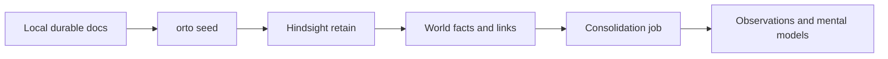

# Developer workflow

Living notes for day-to-day CLI development as we move through roadmap phases. For module boundaries and internals, see [cli-architecture.md](./cli-architecture.md).

This is not the final docs site: it captures the workflow we actually use while building.

## Prerequisites

- Node.js 20+ (22.x is fine)
- pnpm
- A running [Hindsight](https://hindsight.vectorize.io) instance (local Docker is the usual path), typically at `http://localhost:8888`
- The same API key value your Hindsight server was started with (often `HINDSIGHT_API_TENANT_API_KEY` inside the container)

Orto does **not** replace Hindsight. It configures a bank template and retains curated text into that bank.

## Clone, build, and verify the CLI

```bash
git clone <repo-url>
cd orto
pnpm install
pnpm build
pnpm test
pnpm typecheck
pnpm orto --help
```

Preferred local invocations (package `bin` + `pnpm orto` script):

```bash
pnpm orto seed --dry-run
```

Put `orto` on your PATH, then run it **from the other project’s directory** (`pnpm orto` only works inside this clone):

```bash
# in the Orto clone
pnpm build && npm link

# in the other repo (Strumentario, Maglio, a fixture, …)
cd /path/to/your-project
orto --help
orto init
orto configure
orto seed --dry-run
```

Without linking: `/path/to/orto/bin/orto.js` from that same directory.

`npm link` works without extra configuration. For the pnpm equivalent, run `pnpm setup` once and start a new shell before `pnpm link --global`, otherwise pnpm reports `ERR_PNPM_NO_GLOBAL_BIN_DIR`.

Unlink with `npm unlink -g @orto-ai/cli` or `pnpm unlink --global @orto-ai/cli`. The link resolves to your clone, so a plain `pnpm build` picks up code changes.

Rebuild after TypeScript changes before dogfooding:

```bash
pnpm build
```

## Phase 1-3 happy path (first seed + agent wiring)

From the project you want to seed (this repo when dogfooding):

### 1. Initialize config

```bash
pnpm orto init
# non-interactive / CI:
pnpm orto init --bank-id my-app --container-name hindsight --yes
```

In a TTY, `init` prompts for:

1. **Hindsight bank id** (default: slug of the project directory name)
2. **Docker container name** for the local Hindsight server (default: `hindsight`)

Volume is derived as `{containerName}-data`. One Docker container can host many banks: choose a shared server name, not a per-bank container.

Creates version-controlled `.orto/config.json` (`bankId`, optional `docker`, provider, etc.). Re-run needs `--force`. Flags: `--name`, `--bank-id`, `--container-name`, `-y`/`--yes`.

### 2. Generate the Hindsight bank template

```bash
pnpm orto configure
# or preview only:
pnpm orto configure --dry-run
```

Writes `.orto/hindsight/bank-template.json`. Apply it with `orto bank apply` (or `orto configure --apply`) so mission/directives match the project, or create an empty bank with the same `bankId` and refine later.

### 3. Local Hindsight (optional helper)

```bash
pnpm orto docker print             # show docker run without executing
OPENAI_API_KEY='…' pnpm orto docker up
pnpm orto docker status
```

Uses `ghcr.io/vectorize-io/hindsight:latest` (API `:8888`, UI `:9999`). Container/volume resolve as: `--name` flag → `docker` in `.orto/config.json` → defaults `hindsight` / `hindsight-data`. Pass `--api-key` to enable tenant auth on the container. `--dry-run` on `up` prints the command only.

For local Ollama, `reflect` and mental-model refresh require a tool-calling model (verify with `ollama show <model>` that `tools` is listed). On 16 GB machines, keep retain on a smaller model and override reflect:

```bash
pnpm orto docker up \
  --llm-provider ollama \
  --llm-model qwen2.5:7b \
  --llm-base-url http://host.docker.internal:11434/v1 \
  --reflect-llm-model llama3.1:8b
```

### 4. Preview what would be retained

```bash
pnpm orto seed --dry-run
```

No API calls. Prints scored candidates from README, docs/**, ADRs: plus skips (empty files, low-signal sections, unchanged sources).

### 5. Live seed into Hindsight

Use the **secret value** of your tenant API key (not the env var name). Prefer a real key; do not paste a Unicode `…` placeholder into the shell.

```bash
# key only for this process
ORTO_HINDSIGHT_API_KEY='your-actual-key' pnpm orto seed

# or pull from a running Docker container (use your container name from init / config)
ORTO_HINDSIGHT_API_KEY="$(docker exec hindsight printenv HINDSIGHT_API_TENANT_API_KEY)" \
  pnpm orto seed
```

Equivalents:

```bash
export ORTO_HINDSIGHT_API_KEY='your-actual-key'
pnpm orto seed

pnpm orto seed --api-key 'your-actual-key'
```

Optional overrides:

| Flag / env | Purpose |
|------------|---------|
| `--hindsight-url` / `ORTO_HINDSIGHT_URL` / `HINDSIGHT_URL` | Base URL (default `http://localhost:8888`) |
| `--api-key` / `ORTO_HINDSIGHT_API_KEY` / `HINDSIGHT_API_KEY` | Bearer token for retain |
| `--force` | Re-seed even when content hashes match |
| `--async` | Submit retain via Hindsight async ops and poll progress % when available |

Default sync mode retains **one candidate at a time**, prints a do-not-interrupt warning, and shows `[i/N] percent` of items. Each item often takes several seconds (Hindsight LLM extraction). A full first seed can take a few minutes: that is expected.

### What you will see during processing

After the candidate plan, Orto prints a retain warning: **do not close the terminal or press Ctrl+C** until it reports completion:

```text
============================================================
Hindsight is processing retain requests.
Do not close this terminal or press Ctrl+C until Orto reports completion.
Sync mode: 28 item(s); each can take several seconds. Progress shows as percent of items.
Interrupting mid-retain can leave a partial bank; re-run seed (use --force if needed).
============================================================
```

Progress then advances per item:

```text
Retaining 28 item(s) synchronously (LLM extraction per item).
Progress:
  [1/28] 0%  starting  orto:docs/cli-architecture.md#extractor-how-candidates-are-chosen
  [1/28] 4%  done      orto:docs/cli-architecture.md#extractor-how-candidates-are-chosen
  [2/28] 4%  starting  orto:docs/cli-architecture.md#architecture-overview
  ...
```

On success you should see a final summary (retained count + manifest path). Hindsight may still run **consolidation** afterward in the dashboard: that is separate background work and is safe after the CLI exits.

If you see `401 Unauthorized`, set the API key (see above) and re-run. Auth errors stop early so you are not stuck through every item.

With `--async`, Orto polls Hindsight’s operations API for `processed`/`total` when the server provides a progress snapshot (same data the dashboard uses). Piping Docker logs is not supported: use the API or the Hindsight UI.

### 6. Wire agents to the bank

```bash
pnpm orto mcp                      # print Cursor / Claude Code / Roo / Codex / Kiro snippets
pnpm orto mcp --write --dry-run    # preview .cursor/mcp.json merge
pnpm orto mcp --write
pnpm orto mcp --write-agents --write-cursor-rules
```

MCP URL is single-bank: `{baseUrl}/mcp/{bankId}/`. Use `--include-auth` so written configs reference `ORTO_HINDSIGHT_API_KEY` via env placeholders (no secrets in git).

## What “seed” actually does

Unlike older file upload / sync scripts, Orto does **not** upload markdown files into Hindsight as a document corpus.

1. Scan durable sources locally (sensitive paths like `.env` / credentials are excluded)
2. Extract high-signal sections (heuristic, conservative)
3. **Retain** text via Hindsight’s memories API with stable `document_id`s and provenance
4. Hindsight stores **structured memory units** (facts, entities, links), not the raw `.md` tree
5. Write incremental state to `.orto/local/seed-manifest.json` (gitignored)

After retain completes, Hindsight often runs a **Consolidation** background job (observations / mental models). That is normal and usually much faster than re-uploading whole files. Watch **Background Operations** or Bank Configuration → General until consolidation finishes, then refresh Memories / Observations.



## Re-seeding after doc changes

Prefer **retain, then prune** for day-to-day hygiene (same order as [CLI reference](./orto-cli-commands.md#day-to-day-bank-hygiene)):

```bash
pnpm build
pnpm orto store --dry-run   # or seed --dry-run while bootstrapping
ORTO_HINDSIGHT_API_KEY='…' pnpm orto store --yes
pnpm orto prune --dry-run
pnpm orto prune             # TTY multi-select, or --document-id / --source with --yes
```

Unchanged sources (same content hash) are skipped on retain. Use `--force` to re-retain everything, including tombstoned ids.
`store` / `seed` only add or upsert.
Prune removes path-gone / section-gone (or explicit) bank documents and writes `.orto/local/tombstones.json`.

## Dogfooding this repository

This repo already has `.orto/` checked in for dogfooding. The **bank id** `orto` is a project choice (this product’s own bank). The CLI / pnpm command is also named `orto`: that is package branding, not a default for other projects. Local Docker defaults to container `hindsight` (shared server; many banks can live there).

Typical loop:

1. Change code or docs
2. `pnpm build && pnpm test`
3. `pnpm orto store --dry-run` (or `seed --dry-run`)
4. Live `store` / `seed` when you want the bank updated
5. `pnpm orto prune --dry-run` after renames, deletes, or heading drift; prune selected leftovers
6. Confirm in the Hindsight UI for bank `orto`

Empty placeholders such as `docs/dev-workflow.md` (before content landed) are skipped as “no high-signal sections” / empty: expected.

## Common issues

| Symptom | Likely cause |
|---------|----------------|
| `ByteString` / character 8230 | Literal `…` used as the API key: use the real secret |
| `401 Invalid API key` | Wrong key, or key not passed; must match server tenant key |
| Retain `500` / `Fact extraction failed` / `ConnectError` | Hindsight cannot reach its LLM: if using Ollama, start it and ensure the container can reach the host URL |
| CLI “stuck” with no new lines | Sync retain waiting on LLM extract; watch container logs or rebuild for `[i/N]` progress |
| Dashboard shows 0 mid-run | Refresh after items complete; consolidation may still be running |
| `Bank template already exists` | Use `configure --force` or skip if template is fine |
| Already initialized | Use `init --force` only if you intend to reset config |
| Stale bank docs after rename/delete | Retain does not remove old ids; run `prune --dry-run` then selective prune |
| Prune lists a live `orto:path#section` | Current extract no longer emits that id (heading renamed, filtered, or removed): review before delete |

## Current phase checklist

**Done (Phase 0-3, plus prune v1)**

- [x] TypeScript CLI skeleton
- [x] `init` / `configure` / `seed --dry-run` / live `seed`
- [x] Incremental manifest under `.orto/local/`
- [x] `orto store` (allowlist-gated ongoing retain)
- [x] `orto prune` (path-gone / section-gone / explicit + tombstones)
- [x] `orto docker` local Hindsight helper
- [x] `orto mcp` snippets + optional AGENTS / Cursor rules writes
- [x] Architecture + this workflow doc

**Next**

- [x] Phase 4: bank hygiene (`orto prune` v1)
- [x] Phase 5: multi-repo MCP DX, template apply, shareable configs & deployment profiles ([Strumentario gaps](./phase-4-dogfood-gaps.md); [zanuka-web gaps](./phase-5-dogfood-gaps.md))
- [x] Phase 6: mental models (Hindsight curated reflect): [mental-models.md](./mental-models.md); design: [hindsight-mental-models.md](./hindsight-mental-models.md); dogfood: [phase-6-dogfood-gaps.md](./phase-6-dogfood-gaps.md)
- [ ] Phase 7: optional Jev judgment layer (including `--judge jev` on prune), then reliability & DX ([jev.md](./jev.md), [jev-integration.md](./jev-integration.md))

Update this file when a new command becomes part of the daily loop.

## Related

- [cli-architecture.md](./cli-architecture.md): modules, env resolution, seed / prune pipeline
- [orto-cli-commands.md](./orto-cli-commands.md): command and flag reference
- [hindsight-cloud.md](./hindsight-cloud.md): Hindsight Cloud vs local Docker
- [dev-testing.md](./dev-testing.md): end-user command sequence and E2E checklist
- [sensitive-data.md](./sensitive-data.md): secrets allowlist/denylist policy
- [ROADMAP.md](../ROADMAP.md): phased plan
- [CONTRIBUTING.md](../CONTRIBUTING.md): PR and setup conventions
- [AGENTS.md](../AGENTS.md): project principles
